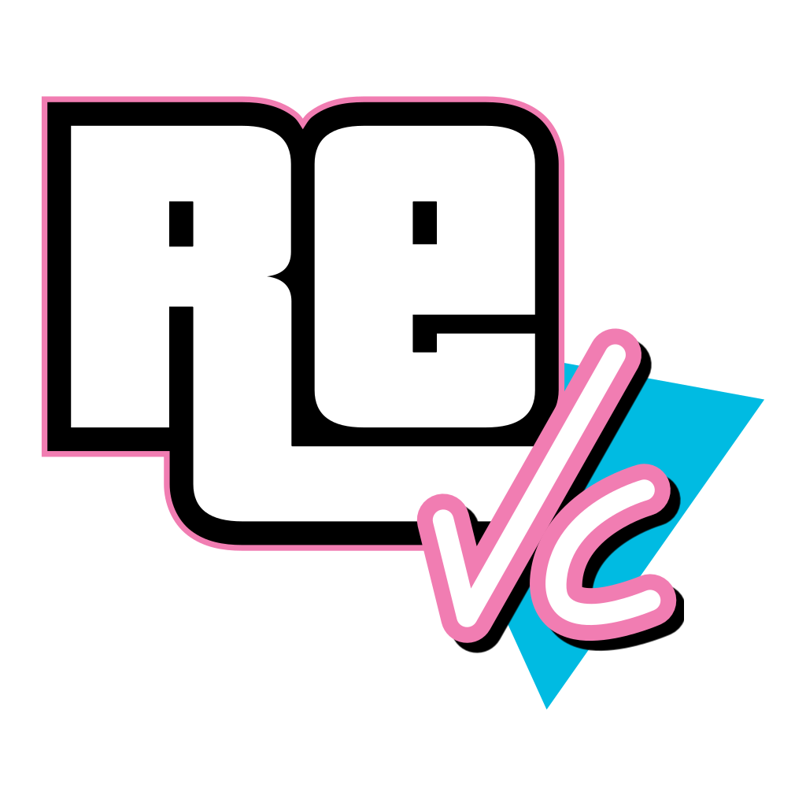

# reVC-PS3



**Grand Theft Auto: Vice City, ported natively to the PlayStation 3.**

reVC-PS3 is a PS3 homebrew port of the reverse-engineered Grand Theft Auto: Vice City codebase. Developed by **Gamer100_Dev with OpenAI Codex**, the project brings Vice City to the PlayStation 3 using PSL1GHT, a custom RSX hardware-rendering backend, PS3-specific platform code, and the original game's PC assets.

The goal is to deliver a faithful, responsive Vice City experience while making the most of the PS3's Cell Broadband Engine, SPUs, and RSX graphics processor.

This project is related to [re3-PS3](https://github.com/stingziz0u/re3-PS3), the PS3 port of Grand Theft Auto III.

> **Current release: 1.1.1 Alpha**
>
> The project has undergone extensive automated gameplay testing on real PS3 hardware, including missions, side activities, vehicles, garages, collectibles, map traversal, and saving and loading. However, it has not yet received extensive full-length playthrough testing.
>
> Expect bugs and occasional compatibility issues. Please report problems through the GitHub Issues page and include the game log whenever possible.

**No copyrighted game assets are included.** You must supply the required data files from your own legally obtained PC copy of Grand Theft Auto: Vice City.

## Features

### Native PS3 rendering

- Custom RSX hardware renderer through the PS3 backend of librw.
- Native 720p rendering.
- Tiled colour and depth buffers, compressed depth, and ZCULL support.
- Support for the PC game's original models, textures, animations, and data files.
- DXT1 texture optimisation to reduce video memory usage.
- Configurable 30 FPS and 60 FPS modes, synchronised with the display to avoid tearing.

### Gameplay and controls

- PS2-style controller configuration adapted for the DualShock 3.
- Lock-on aiming, configurable pad layouts, inverted camera controls, and free-camera settings.
- PlayStation button prompts in the on-screen help.
- Pause-menu map with a legend and waypoint selection.
- Saving and loading using PS3-compatible save files.
- Support for missions, side activities, vehicles, garages, collectibles, and other original gameplay systems.

### Audio and customisation

- Original Vice City radio stations.
- MP3 player station using personal MP3 files.
- Custom player skins using BMP files.
- Custom textures, vehicle models, character models, fonts, HUD assets, loading screens, and compatible PC-format data modifications.
- Configurable screen size for television overscan.
- Optional FPS counter.

## Performance and optimisation

Performance is a major focus of reVC-PS3. The project includes platform-specific improvements intended to make better use of the PS3's hardware while retaining the original game's behaviour.

### RSX and graphics optimisation

The custom rendering backend takes advantage of PS3-specific graphics features, including tiled render targets, compressed depth, and ZCULL. DXT1 textures are stored in a reduced-memory format where supported, helping preserve video memory for geometry, textures, and other rendering resources.

The renderer targets consistent frame pacing at either 30 FPS or 60 FPS, with synchronisation to the display.

### Cell processor and SPU optimisation

The port includes PS3-specific processing paths, including SPU-assisted particle jobs. Parallel work is intended to reduce unnecessary PPU workload while allowing the main game loop to continue running smoothly.

Ongoing optimisation work includes:

- Improving the reliability of SPU job completion and recovery.
- Detecting stalled particle jobs and safely falling back to PPU simulation when necessary.
- Avoiding incomplete or stale data being consumed after a failed SPU job.
- Reducing unnecessary synchronisation waits without compromising correctness.
- Investigating audio-stream buffering and station-switching performance.
- Improving lighting correctness and consistency in the RSX backend.
- Profiling CPU and GPU workloads to identify frame-time spikes rather than applying blind optimisations.

Some of these areas remain under development. A successful build alone does not establish that every performance or rendering issue has been resolved. Fixes must be validated with appropriate runtime testing.

### Performance expectations

The project has achieved approximately 60 FPS across its automated test scenarios, depending on the tested scene and configuration. Actual performance can vary with rendering conditions, settings, and the specific console setup.

## Requirements

- A PlayStation 3 with compatible homebrew support through CFW or HEN.
- The reVC-PS3 installation package.
- A legally obtained PC copy of Grand Theft Auto: Vice City.
- An FTP client or another suitable method for transferring files to the console.

The project is built using [PSL1GHT](https://github.com/ps3dev/ps3toolchain) and the PS3 development toolchain.

## Installation

### 1. Install the package

Install `revc-ps3-1.1.1-alpha.pkg` on your PS3 using your preferred homebrew package manager.

Once installed, reVC should appear in the XMB.

### 2. Copy the game data

The game uses the following directory:

`/dev_hdd0/game/REVCPS300/USRDIR`

Copy the corresponding folders from your PC installation of Vice City into `USRDIR` using FTP or another file-transfer method.

| Directory | Contents |
|---|---|
| `anim` | Original game animations |
| `audio` | Radio station audio and other game sounds |
| `data` | Game configuration, handling, scripts, and other data |
| `models` | Original models and model archives; preserve the reVC-provided TXD files |
| `text` | Language and text resources |
| `txd` | Texture dictionaries and loading-screen resources |
| `mp3` | Optional personal MP3 files |
| `skins` | Optional BMP player skins |

Keep the directory names lowercase as shown above.

The original PC `movies` and `mss` directories are not required by this build.

### 3. Launch the game

Start reVC from the XMB. The game will load its assets from the installed `USRDIR` directory.

If you experience a startup failure or rendering problem, see the troubleshooting section below and report the issue if the suggested workaround does not help.

## Customisation and mod support

reVC-PS3 supports many standard PC-version Vice City assets and data modifications.

Supported examples include:

- TXD textures, including replacement HUD elements, fonts, vehicles, characters, buildings, and loading screens.
- DFF models in the original PC game's format.
- Compatible game data files such as `handling.cfg`, `carcols.dat`, `timecyc.dat`, and `gta_vc.dat`.
- Modified `main.scm` scripts.
- Personal MP3 music and BMP player skins.

Assets may be supplied as loose files or through supported game archives, including `gta3.img` and its corresponding `gta3.dir`.

### Modding limitations

The RSX has a limited video memory budget. DXT1 textures use approximately two bytes per pixel in the project's reduced-memory format, while other texture formats generally use four bytes per pixel when uncompressed.

Large texture packs, especially those that replace most textures with high-resolution 1024 × 1024 or larger assets, can exhaust available video memory. This may cause missing models, white textures, or other rendering problems.

The maximum supported texture dimension is 4096 × 4096, subject to available memory and rendering constraints.

Code modifications designed for PC injection frameworks, including CLEO scripts, ASI plugins, and executable-patching plugins, are not supported by this native PS3 port. Assets from other games or platforms are not guaranteed to work.

## Troubleshooting

### Black screen during startup

Create an empty file named `notiles.txt` in `USRDIR`. This disables tiled buffers and can help identify problems with the tiled rendering path.

If the black screen persists, report the problem with the game log.

### Incorrect textures

Create an empty file named `dxt32.txt` in `USRDIR` to disable the reduced-memory DXT1 texture path and return DXT1 textures to 32-bit storage.

### Crashes, freezes, or unexpected behaviour

The game log is located at:

`USRDIR/revc-ps3.log`

The previous log may be retained as:

`USRDIR/revc-ps3.old.log`

Include the relevant log when opening an issue. The log can help identify the last game subsystem being executed before a crash or freeze, although the last recorded function is not necessarily the root cause.

### Automatic testing

Create `autotest.txt` in `USRDIR` to activate the built-in automated tests. Before using it, load a save in a safehouse with no mission active.

Supported test configurations include:

- **Default mode:** Weather changes, map traversal, save/load, vehicle tests, side activities, and garages.
- **Full mode:** Mission and activity testing. This can change mission progress and money, so do not save afterwards.
- **GPU mode:** Graphics benchmark.
- **Rain mode:** Rain-related rendering tests.
- **Leak mode:** Resource and memory-leak testing.

The configuration supports options such as `loops=N`, `mode=full`, `secs=N`, `from=N`, `to=N`, and `resume=0`. The exact behaviour is determined by the current automated-test implementation.

When the test finishes, its configuration file is renamed to `autotest.done.txt`.

## Building from source

The project can be built on Linux or WSL using Ubuntu with the PS3 toolchain and PSL1GHT installed.

### Prerequisites

Install and configure the [ps3dev toolchain](https://github.com/ps3dev/ps3toolchain). The default paths in the commands below assume the toolchain is installed under `/usr/local/ps3dev`.

### Clone and build

```sh
git clone https://github.com/stingziz0u/reVC-PS3.git
cd reVC-PS3

export PS3DEV=/usr/local/ps3dev
export PSL1GHT=/usr/local/ps3dev
export PATH="$PS3DEV/bin:$PS3DEV/ppu/bin:$PATH"

make -C ps3 -j"$(nproc)"
make -C ps3 verify
```

The resulting package is:

`ps3/revc-ps3-1.1.1-alpha.pkg`

### Additional build targets

```sh
make -C ps3 DEBUG=1
make -C ps3 FTRACE=1
make -C ps3 STAGE=1
make -C ps3 crash LOG=revc-ps3.log
make -C ps3 clean
```

- `DEBUG=1`: Debug build with assertions.
- `FTRACE=1`: Function tracing for selected gameplay subsystems.
- `STAGE=1`: Headless testing build for loading and diagnostics without normal video, audio, or controller output.
- `crash LOG=...`: Resolves logged crash addresses into function names for the matching build.
- `clean`: Removes generated build files.

### RSX shaders

The compiled RSX shaders are included in:

`vendor/librw/src/ps3/ps3shaders.h`

Rebuilding modified shaders requires NVIDIA's `cgc`, PSL1GHT's `cgcomp`, and the project's `cgcomp-relative-constants.patch`. The shader build script is located at:

`vendor/librw/src/ps3/shaders/build_shaders.sh`

## Project structure

| Path | Purpose |
|---|---|
| `ps3/` | PS3 build system, package configuration, and diagnostic tools |
| `src/skel/ps3/` | Platform entry point, main loop, filesystem, controller, logging, and testing |
| `src/audio/sampman_ps3.cpp` | PS3 audio backend, software mixer, radio streams, MP3, WAV, and ADF handling |
| `vendor/librw/src/ps3/` | RSX renderer, graphics resources, shaders, and PS3-specific rendering code |
| `src/core/config.h` | Platform-specific feature configuration |
| `README.reVC.md` | Original upstream reVC documentation |

## Bug reports and contributions

**Found a bug, performance issue, graphical glitch, freeze, or compatibility problem? Please open an issue on GitHub.**

[Open a GitHub issue](https://github.com/stingziz0u/reVC-PS3/issues)

To make a report useful, please include:

1. A clear description of the problem and what you expected to happen.
2. Steps to reproduce the problem, including the mission, location, vehicle, or radio station involved where relevant.
3. Whether you are using a real PS3 or an emulator, along with your relevant console or emulator configuration.
4. The version or commit you built and any non-default game settings.
5. `revc-ps3.log`, plus any relevant screenshots, videos, or additional diagnostic output.

For freezes, explain what was happening immediately beforehand and whether the problem occurs consistently or intermittently.

For performance reports, include the frame-rate setting, scene, and whether the issue occurs during particular effects, loading operations, radio switching, or other identifiable events.

Please avoid duplicate reports. Check the existing issues first, and add your information to an existing report when it describes the same problem.

Do not upload copyrighted game data, proprietary game assets, or complete commercial game files to bug reports.

Contributions, reproducible test cases, profiling results, and technically justified optimisation patches are welcome.

## Credits and acknowledgements

- **Gamer100_Dev:** Project development, PS3 porting, debugging, and optimisation.
- **OpenAI Codex:** AI-assisted coding, debugging, and implementation support.
- **re3 team:** Original reverse-engineered reVC codebase.
- **aap and librw contributors:** Rendering foundation.
- **ps3dev contributors:** PSL1GHT and PS3 development toolchain.
- **lieff:** [minimp3](https://github.com/lieff/minimp3).

This project builds on the work of the original reVC and librw communities. Please consult the relevant upstream licences for their respective code and dependencies.

## Development disclosure

reVC-PS3 is developed by **Gamer100_Dev in collaboration with OpenAI Codex**. Codex assists with implementation, code analysis, debugging, and optimisation, while development decisions and testing are directed by the project maintainer.

## Disclaimer and licence

See [LICENSE](LICENSE) for the project's licence.

Grand Theft Auto: Vice City is © Rockstar Games / Take-Two Interactive. This is an independent community project and is not affiliated with, endorsed by, or sponsored by Rockstar Games, Take-Two Interactive, or Sony Interactive Entertainment.

You must supply your own legally obtained copy of the game. No commercial game data is distributed with this project.
